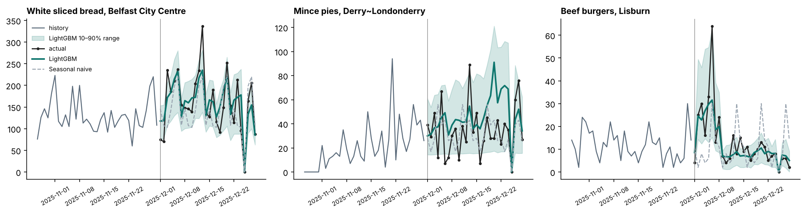
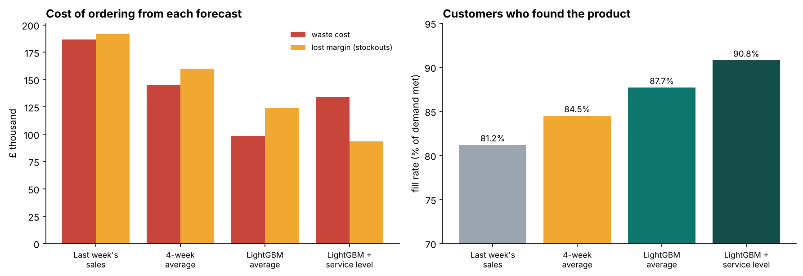
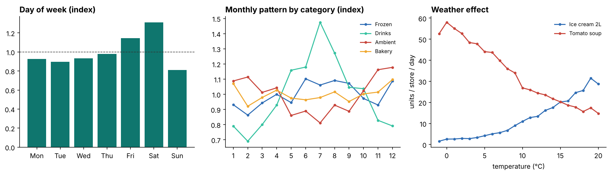
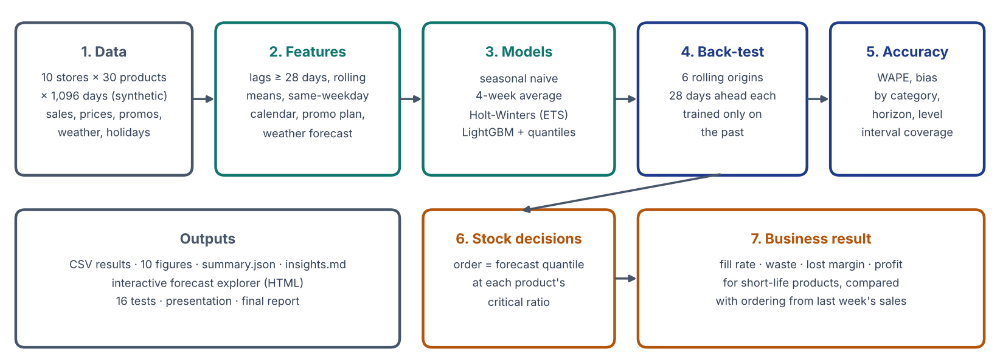

# Retail Demand Forecasting

This project forecasts daily sales for every store and product in a grocery chain four weeks ahead, tests the forecasts honestly on data they have never seen, and turns them into **stock orders**. It then measures what better forecasts are worth in waste, stockouts and profit.

> **All data is synthetic.** "Harbour Fresh" is a fictional chain of 10 stores in Northern Ireland with 30 products over three years (2023–2025). The data is generated by code with realistic, known effects (see below), so the results show method, not facts about a real business.



## Results at a glance

Six rolling 28-day back-tests (July–December 2025, including the run-up to Christmas), 49,296 store-product-days:

| Forecast | WAPE ↓ | Bias |
|---|---|---|
| Seasonal naive (same day last week) | 45.3% | −1.0% |
| 4-week same-weekday average | 37.2% | −0.8% |
| Holt-Winters exponential smoothing (per series) | 34.6% | −7.3% |
| **LightGBM global model** | **27.4%** | **−1.3%** |
| *Best possible: the true average demand* | *26.7%* | *+0.5%* |

*WAPE = total absolute error ÷ total units sold. Lower is better.*

* LightGBM has **39% less error than the naive forecast and 21% less than the best baseline**.
* It comes within 0.7 points of the best possible score. Daily sales of one product in one store are noisy, so even a perfect forecast of the average is 26.7% "wrong" on the day. The project measures this floor directly, which few forecasting projects do.
* On **promotion days** the baselines under-forecast by 41–44%, because they don't know a promotion is planned. LightGBM's bias is −3% and its WAPE is 27.9%, against 47–49% for the baselines.
* **Errors cancel when added up:** 27.4% at store-product-day level, 6.4% per store per day, and 2.4% for the whole chain per day.

### What it is worth: ordering short-life products

For the 11 products with a shelf life of 7 days or less (bread, fruit, salad, milk, meat), each store orders daily. Results over the 24 test weeks across 10 stores:

| Order policy | Fill rate | Waste (% of order) | Net profit | Total mismatch cost* |
|---|---|---|---|---|
| Order last week's sales | 81.2% | 20.0% | £533k | £458k |
| 4-week average | 84.5% | 16.1% | £607k | £371k (−19%) |
| LightGBM forecast | 87.7% | 11.6% | **£689k** | £273k (−40%) |
| **LightGBM + target service level** | **90.8%** | 15.3% | £684k | **£267k (−42%)** |

*Waste cost + lost margin + lost goodwill on unmet demand.

Ordering from LightGBM instead of last week's sales adds **£156k of profit** over the test period and nearly halves waste. Ordering at a product-specific **service level** means ordering a forecast quantile at the newsvendor critical ratio. It lifts availability to 90.8% for slightly more waste, and it has the lowest total cost once lost customer goodwill is counted.



## Honest findings and limitations

* **The data is synthetic, and the model can see every driver** that generated it. Real data has unknown drivers such as competitors, local events and data errors, so expect higher errors on real data. The *ranking* of methods and the *process* are the transferable parts.
* **The ranges are slightly too narrow.** The 10–90% range contains 76% of actual demand, against a target of 80%; the 10% quantile is too high. The service-level policy would gain from calibrating them, for example with conformal prediction.
* **Weather sensitivity is underestimated by about a third.** The model attributes part of the warm-weather effect to the time of year. Promotion uplift is recovered well: the predicted uplift per product closely tracks the true uplift built into the data.
* **One model covers horizons 1–28 days,** so it only uses history at least 28 days old. Accuracy is flat across the four weeks, but short horizons could use fresher data with separate models per week.
* **Holt-Winters is biased low (−7%),** because it was fitted on log sales and back-transforming the log gives roughly the median rather than the mean.
* **The inventory simulation is a one-day newsvendor model.** It does not model multi-day shelf life, lead times or case sizes.

## Built-in effects (the "known truth")

| Effect | How it appears in the data |
|---|---|
| Day of week | Saturday peak; Sunday low (Northern Ireland Sunday trading 1–6 pm) |
| Seasonality | Drinks and frozen peak in summer, soup in winter; Christmas run-up; post-Christmas dip |
| Closures | Large stores closed on Christmas Day and Easter Sunday (Northern Ireland rules) |
| Events | Mince pies (Nov–Dec), Easter eggs (6 weeks before Easter), pancake mix (Shrove Tuesday) |
| Weather | Ice cream, water, burgers and salad up when warm; soup up when cold |
| Promotions | 20–33% off for 1–2 weeks; uplift = price ratio ^ elasticity; storable goods dip afterwards |
| Other | Payday (last Friday) uplift, 3% chain growth, declining cola, oat drink launched in March 2024 |
| Stockouts | About 1.6% of days, with sales capped below demand and flagged |



## Method



1. **Features** (`features.py`). Every history feature is at least 28 days old: lags of 28–56 and 364 days, rolling means over 7, 28 and 91 days, the same-weekday average, and the chain-level product average. Known-in-advance plans are used for the target day: calendar, holidays, promotions and prices, store closures, and a weather forecast whose error grows with the horizon. **Stockout and closed days are blanked from the history**, so the model learns demand, not lost sales. A test proves there is no leakage: changing future sales does not change any earlier feature.
2. **Models** (`models.py`)
   * Three baselines a retailer might already use.
   * One **LightGBM** model for all 300 series with a Tweedie objective, which suits counts with zeros.
   * Four **quantile** models (10%, 50%, 75%, 90%) for ranges and ordering.
3. **Back-test** (`backtest.py`). There are six origins, every four weeks, each with an expanding training window. Nothing after the origin is used.
4. **Evaluation** (`reporting.py`)
   * WAPE and bias by model, fold, category, horizon, promotion and aggregation level.
   * Interval calibration and the "best possible" floor.
   * The promotion and temperature effects the model learned, compared with the truth.
5. **Stock policy** (`inventory.py`). Newsvendor ordering at each product's critical ratio, using underage cost = margin + goodwill and overage cost = cost − salvage.

## Project structure

```
demand-forecasting/
├── src/demand_forecasting/
│   ├── config.py          settings: folds, horizon, quantiles, LightGBM parameters
│   ├── generate_data.py   synthetic chain: sales, prices, promotions, weather, holidays, stockouts
│   ├── features.py        leak-free features for a direct 1–28 day forecast
│   ├── models.py          seasonal naive, 4-week average, Holt-Winters, LightGBM (+ quantiles)
│   ├── backtest.py        rolling-origin back-test + counterfactual checks
│   ├── metrics.py         WAPE, bias, MAE, RMSE, coverage, pinball loss
│   ├── inventory.py       newsvendor order policies and their cost
│   ├── reporting.py       result tables, 10 figures, interactive explorer, insights
│   └── __main__.py        CLI: data | backtest | all
├── data/sample/           one store's December 2025 data (the full data is regenerated)
├── outputs/results/       CSV tables, summary.json, insights.md, back-test predictions
├── outputs/figures/       10 charts
├── outputs/interactive/   forecast_explorer.html: choose a product (2 stores) and compare forecasts
├── tests/                 16 pytest tests (data, leakage, models, metrics, inventory)
├── docs/                  architecture, presentation (.pptx), final report (.docx/.pdf)
└── scripts/               one-click run scripts
```

## Quick start

```bash
python -m venv .venv
.venv\Scripts\activate             # Windows  (macOS/Linux: source .venv/bin/activate)
pip install -r requirements.txt
pip install -e .

python -m demand_forecasting all   # generate data + 6-fold back-test (about 5 minutes)
pytest                             # 16 tests
start outputs\interactive\forecast_explorer.html     # macOS: open ... / Linux: xdg-open ...
```

For a quicker run, set `DF_FOLDS=2` (PowerShell: `$env:DF_FOLDS=2`) to back-test only the last two folds.

## Skills shown

Time-series forecasting · feature engineering without leakage · gradient boosting (LightGBM, Tweedie and quantile objectives) · classical benchmarks (exponential smoothing) · rolling-origin back-testing · forecast evaluation (WAPE, bias, calibration, aggregation levels) · inventory optimisation (newsvendor, service levels) · turning model output into business value · testing · data visualisation.

## Licence

MIT © 2026 Mohamed Moin Peer. The data is synthetic and generated by `generate_data.py`.
